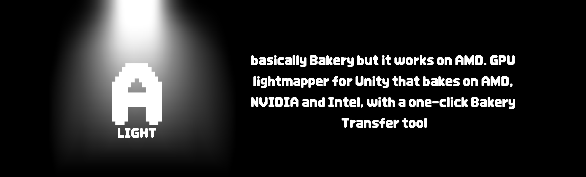

  

  
  
  

# A-Light

basically Bakery but it works on AMD 🤷

i have an AMD gpu and Bakery straight up refuses to bake on anything that isnt NVIDIA, so i made my own lightmapper. it runs on compute shaders instead of CUDA so it works on AMD, NVIDIA and Intel. it also has a Bakery Transfer button that turns all your Bakery lights into A-Light lights so you dont have to redo your whole map

its still in beta so expect some weird stuff. if something breaks pls open an issue

## what it does

- bakes lightmaps on basically any gpu (DX11 works fine)
- hardware ray tracing if youre on Unity 6 / 2023.1+ with DX12 (AMD RX 6000+, RTX, Intel Arc)
- **Bakery Transfer**: converts Bakery point, direct, sky and light mesh lights, and copies your Bakery bake settings too
- direct light, bounce light (GI), sky light, emissive stuff, area lights, AO, shadowmask, light probes, all the normal stuff
- soft shadows + a denoiser so it doesnt look crusty
- the settings window is laid out like Bakery's so you can find everything

## how to install

1. grab `A-Light.unitypackage` from [releases](../../releases)
2. in unity go **Assets › Import Package › Custom Package** and import it
3. open **Tools › A-Light › Lightmapper**

if the package wont import for some reason, unzip `A-Light-folder.zip` into your Assets folder instead

you need **Unity 2022.3 or newer**. thats what i use

## switching from Bakery

1. **keep Bakery installed** for this part, the transfer tool needs to read its components (it still compiles on AMD, it just cant bake)
2. go to **Tools › A-Light › Bakery Transfer** and hit **Transfer**. at the end it asks if you want to match the lights Bakery actually used in its last bake, say yes so you dont end up with extra lights
3. open the lightmapper and hit **Render**

it doesnt touch your Bakery lightmaps, A-Light saves to `Assets/ALightLightmaps/` so you can always go back

| Bakery | A-Light |
|---|---|
| Bakery Point Light | A-Light Point Light |
| Bakery Direct Light | A-Light Directional Light |
| Bakery Sky Light | A-Light Sky Light |
| Bakery Light Mesh | A-Light Area Light |

## starting from scratch

1. make your map **Contribute GI** static and set Receive GI to **Lightmaps**
2. add lights from **GameObject › Light › A-Light**
3. hit **Render**

## is it the same as Bakery?

not exactly. Bakery's actual ray tracing code is closed source so i cant copy it (and i wouldnt anyway). A-Light just tries to do what Bakery's manual says it does. its pretty close, and it gets closer every update

if a spot looks wrong, open an issue with a screenshot from A-Light and one from Bakery, same camera angle

## stuff that doesnt work yet

- RNM / SH / MonoSH directional modes (they need Bakery's shaders). use Dominant Direction or Baked Normal Maps instead
- Bakery volumes, sectors and light filters
- skinned meshes
- custom shaders with weird property names might bake as white

## contributing

PRs are welcome, especially if you can test on other gpus or URP/HDRP. bug reports with screenshots help the most

## disclaimer

im not affiliated with Bakery or its dev in any way. Bakery is only mentioned so you know what this is compatible with. all trademarks belong to their owners
